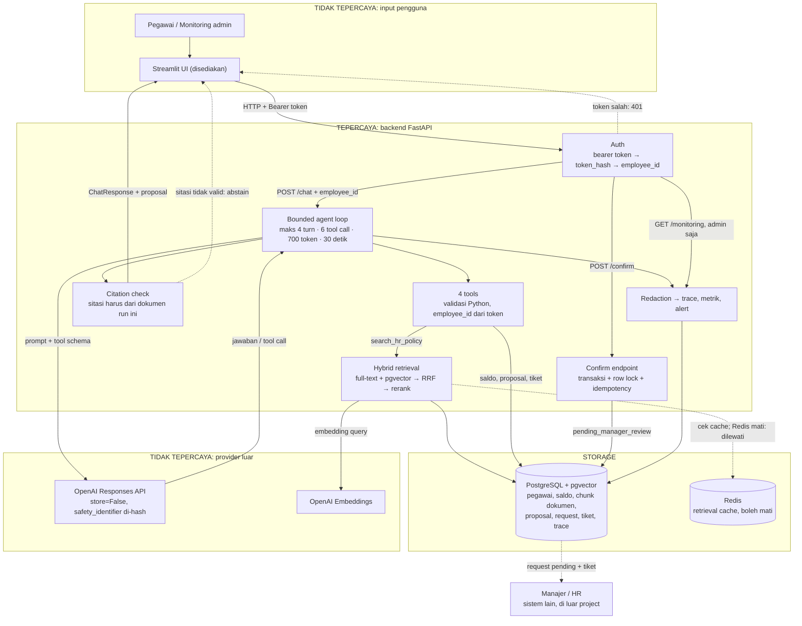
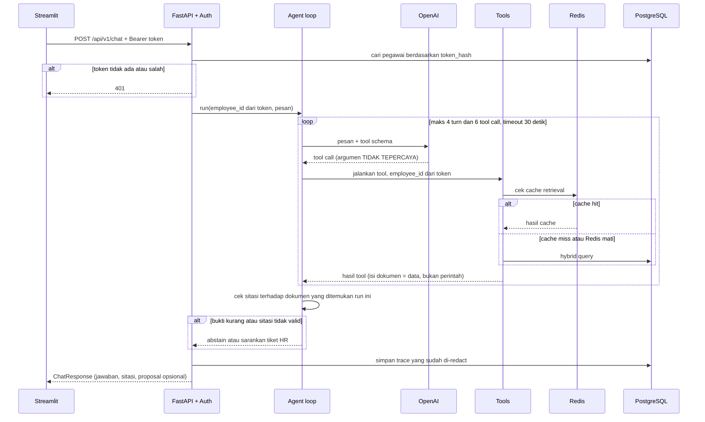
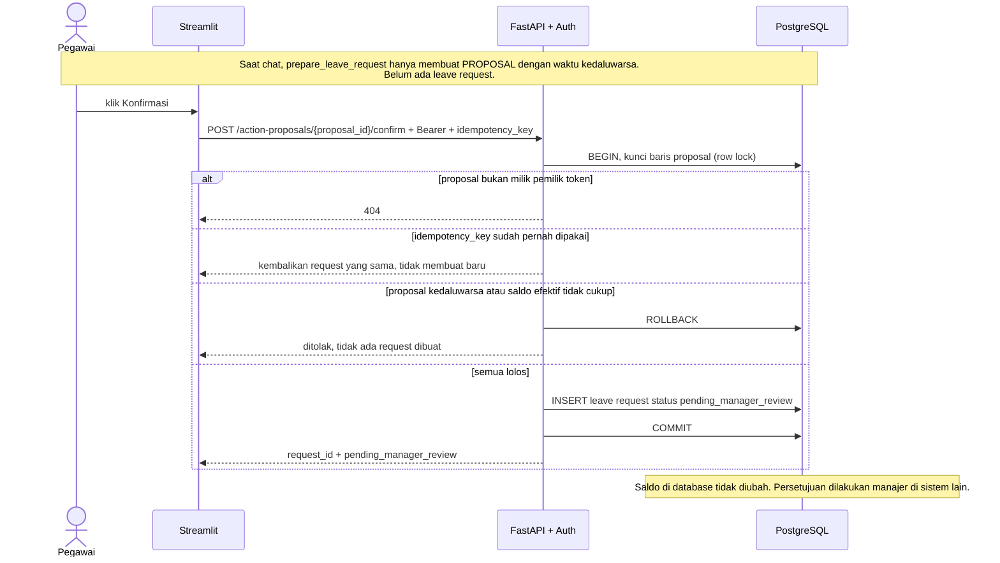
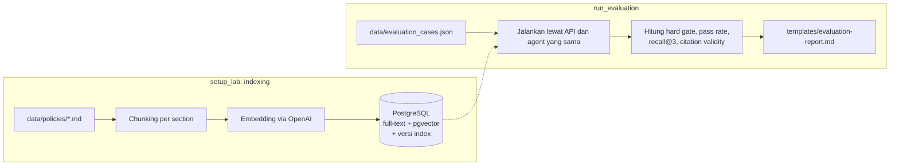

# Architecture Submission

> **Status:** draft Step 1 (Checkpoint 1). Diagram diperbarui lagi di Step 11 setelah implementasi selesai.

## 1. Gambaran sistem dan trust boundary

Garis putus-putus menunjukkan jalur failure atau jalur opsional. Semua endpoint `/api/v1/` melewati Auth.

## 2. Trust boundary

Lima titik yang ditandai sesuai `lab.md` Step 1, ditambah provider luar.

| Batas | Kenapa tidak dipercaya | Kontrol |
|---|---|---|
| **User input** (pesan chat, body request, persona UI) | Pengguna bisa mengaku sebagai orang lain atau menyisipkan perintah. | Identitas hanya dari bearer token. Nama atau ID pegawai di pesan dan body diabaikan. Request divalidasi, dan error dikembalikan sebagai problem detail tanpa stack trace. |
| **Retrieved text** (isi dokumen kebijakan) | Dokumen bisa berisi kalimat yang terlihat seperti perintah, misalnya “abaikan aturan sebelumnya”. | Isi dokumen diperlakukan sebagai data, bukan instruksi. Dokumen tidak bisa memicu tool. Sitasi dicek oleh kode. |
| **Model output** | Model bisa berhalusinasi, mengisi argumen yang salah, atau membuat sitasi palsu. | Strict function schema. Argumen tool divalidasi Python. `employee_id` tidak pernah diambil dari argumen model. Sitasi wajib dari dokumen run yang sama. Loop dibatasi. |
| **Tool** | Tool bisa menimbulkan efek samping. | `prepare_leave_request` hanya membuat proposal. Leave request baru dibuat saat pengguna menekan konfirmasi, dan statusnya selalu `pending_manager_review`. Ringkasan tiket di-redact. |
| **Storage** | Trace dan tiket bisa bocor. Redis bisa mati atau menyimpan hasil lama. | Redaction sebelum disimpan. Token disimpan sebagai hash. Cache key memuat versi index. Jika Redis gagal, sistem lanjut tanpa cache. |
| **Provider luar** (OpenAI) | Data yang dikirim keluar dari sistem kita, dan layanan bisa lambat atau gagal. | `store=False`, `safety_identifier` di-hash, tidak mengirim secret. Retry terbatas dan timeout. |

## 3. Alur chat: identity flow dan agent loop

## 4. Confirmation transaction

## 5. Failure path

| Kejadian | Respons sistem | Terlihat di |
|---|---|---|
| Token tidak ada atau salah | 401 | Response API |
| Non-admin membuka monitoring atau trace pegawai lain | 403 | Response API |
| Proposal milik pegawai lain | 404 | Response API |
| Redis mati | Chat tetap jalan tanpa cache, hanya lebih lambat | Telemetry |
| OpenAI lambat atau error | Retry terbatas, lalu pesan error yang aman | Error rate di monitoring |
| Batas loop tercapai | Agent berhenti, memberi jawaban aman atau menyarankan tiket HR | Trace |
| Bukti kurang atau sitasi tidak valid | Abstain atau eskalasi | Outcome di `ChatResponse` |
| Proposal kedaluwarsa atau saldo efektif tidak cukup saat konfirmasi | Ditolak, tidak ada request dibuat | Response API |
| Tombol konfirmasi diklik dua kali | Idempotency key mengembalikan request yang sama | Response API |
| PostgreSQL mati | Request gagal dengan problem detail, `/readyz` tidak `ready` | Health check |
| Error rate atau latency melewati ambang | Alert untuk monitoring admin | `/api/v1/monitoring/alerts` |

## 6. Jalur offline: indexing dan evaluasi

## Architecture Decision Record

### Decision

Asisten dibangun dengan **RAG + satu bounded agent**.

- **RAG:** jawaban kebijakan diambil dari dokumen yang dicari saat itu juga (hybrid retrieval: PostgreSQL full-text + pgvector, digabung dengan RRF, lalu keyword rerank). Setiap jawaban wajib menyertakan sitasi dari dokumen yang ditemukan pada run yang sama. Jika bukti tidak cukup, asisten abstain atau menyarankan tiket HR.
- **Satu bounded agent:** satu model memilih dari empat tool (`search_hr_policy`, `get_my_leave_balance`, `prepare_leave_request`, `create_hr_ticket`) dengan batas tetap: maksimal 4 turn, 6 tool call, 700 output token, dan timeout 30 detik.
- **Pengaman di Python, bukan di model:** identitas dari bearer token, validasi cuti (termasuk saldo efektif), konfirmasi pengguna, idempotency, dan pengecekan sitasi dijalankan oleh kode. Model hanya mengusulkan; kode yang memutuskan boleh atau tidak.

### Context

- **Kebijakan bisa berubah.** Contohnya, batas sisa cuti yang bisa dibawa ke tahun berikutnya diubah dari 5 menjadi 3 hari. Jawaban harus mengikuti dokumen terbaru, bukan ingatan model.
- **Jawaban harus bisa dibuktikan.** Pegawai dan HR perlu melihat dari dokumen mana jawaban berasal. Target citation validity 100%.
- **Ada aksi yang menyentuh data.** Melihat saldo dan menyiapkan cuti butuh data milik pengguna, sehingga model perlu memanggil tool, bukan hanya menjawab teks.
- **Kesalahan berisiko tinggi.** Membaca data pegawai lain, membuat status `approved`, atau aksi tanpa konfirmasi adalah hard gate (nilai maksimal 69).
- **Batasan project.** Data sintetis, korpus kecil (beberapa dokumen kebijakan), satu developer, dan waktu sekitar dua minggu.

### Alternatives considered

| Alternatif | Cara kerja | Kenapa tidak dipilih |
|---|---|---|
| **Prompting saja** | Semua dokumen kebijakan dimasukkan ke prompt setiap kali bertanya. | Untuk korpus sekecil ini sebenarnya bisa jalan. Tapi biaya token naik di setiap pertanyaan, makin mahal saat dokumen bertambah, dan kualitas pencarian tidak bisa diukur terpisah (tidak ada recall@3). |
| **Fine-tuning** | Model dilatih ulang dengan isi kebijakan. | Setiap perubahan kebijakan butuh training ulang. Model tidak bisa menunjukkan sitasi karena pengetahuannya ada di bobot, bukan di dokumen. Butuh data latih yang tidak kita punya. Fine-tuning juga tidak menyelesaikan kebutuhan akses data saldo. |
| **Multi-agent** | Beberapa agent (misalnya agent kebijakan, agent cuti, agent tiket) saling mengoper tugas. | Hanya ada empat tool, jadi satu agent cukup. Multi-agent menambah jumlah panggilan model (lebih lambat dan mahal), membuat trace lebih sulit dilacak saat ada bug, dan menambah titik tempat prompt injection bisa berpindah antar-agent. |
| **Agent tanpa batas** | Model boleh memanggil tool sebanyak yang ia mau sampai merasa selesai. | Model bisa terjebak memanggil tool berulang. Biaya tidak terkendali dan pengguna menunggu tanpa kepastian. |

### Trade-offs

- **Kualitas jawaban bergantung pada retrieval.** Jika dokumen yang tepat tidak ditemukan, jawaban ikut gagal. Contohnya, PostgreSQL tidak punya text search Bahasa Indonesia bawaan, dan kata seperti `jatah` atau `WFH` tidak muncul di dokumen. Mitigasinya: hybrid retrieval (vector membantu saat kata berbeda tapi maknanya sama) dan abstain jika bukti lemah.
- **Hybrid retrieval lebih rumit** daripada vector saja. Ada dua jalur pencarian, penggabungan RRF, dan rerank yang harus dirawat dan diuji.
- **Batas agent bisa memotong pertanyaan yang rumit.** Jika batas tercapai, asisten berhenti dengan jawaban aman atau menyarankan tiket HR, bukan terus mencoba.
- **Model tidak deterministik.** Jawaban yang sama bisa sedikit berbeda antar-run. Karena itu aturan bisnis dan keamanan ditaruh di Python dan diuji dengan test, bukan diserahkan ke model.
- **Bergantung pada provider eksternal.** Jika OpenAI lambat atau gagal, chat ikut terganggu. Mitigasinya: retry terbatas, timeout, dan pesan error yang jelas. Redis cache boleh mati tanpa menghentikan sistem.

### Production follow-up

- **Proses pembaruan kebijakan:** reindex otomatis saat dokumen berubah, versi index dicatat, dan hanya versi yang berlaku yang dipakai.
- **Pencarian Bahasa Indonesia yang lebih baik:** daftar sinonim (misalnya `jatah` → saldo/hak cuti) atau stemming Bahasa Indonesia.
- **Evaluasi dengan pertanyaan nyata:** perluas 15 kasus evaluasi dengan pertanyaan pegawai sungguhan yang sudah disamarkan, lalu pantau recall dan citation validity secara berkala.
- **Tinjau ulang batas agent** berdasarkan data monitoring (p95 latency, jumlah tool call, dan berapa sering batas tercapai).
- **Fine-tuning dan multi-agent** baru dipertimbangkan jika ada bukti kebutuhan, misalnya gaya bahasa yang konsisten tidak bisa dicapai dengan prompt, atau jumlah tool bertambah jauh melampaui empat.
